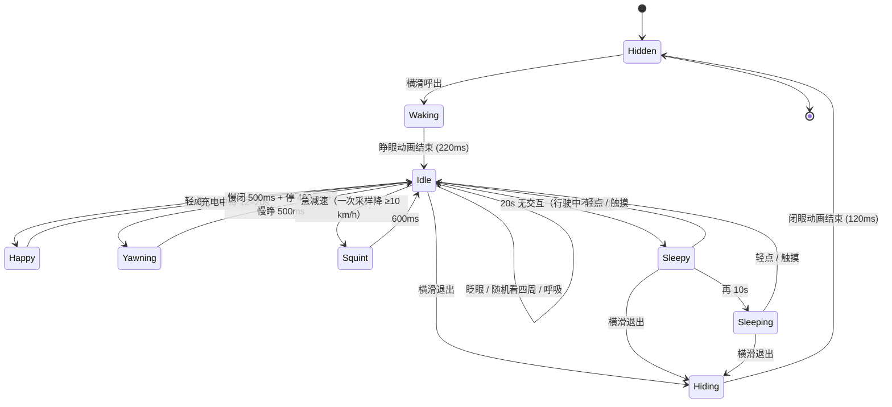

# 离线小精灵 · 设计与实施规划 v0.1

目标硬件：**Waveshare ESP32-S3-Touch-AMOLED-1.75-B**（466×466 圆屏，CST9217 触摸，QMI8658 IMU）。

一句话：**在仪表界面任意页面向左或向右滑动，浮出一只只有两只大眼睛的小精灵；不联网、不说话、不调大模型，纯本地动画。**

- 状态：阶段 1–4 已实现（显隐、眨眼/注视/呼吸、触摸追随、开心、困倦/入睡、充电打哈欠、车速瞳孔/急减速眯眼、耳朵/尾巴），待实机验证
- 关联文档：`design/UI-DESIGN.md`（仪表界面）、`README.md`（固件说明）
- 本文所有坐标均为 LVGL 画面坐标（已按屏幕旋转换算后的坐标）

---

## 1. 目标与非目标

### 1.1 目标

1. **离线**：不依赖 Wi-Fi、BLE、云端、ASR/LLM/TTS，断网、无车、无手机都能玩。
2. **可爱**：两只大眼睛会眨眼、会看人、会跟着手指转、会困；交互反馈在 100ms 内。
3. **不打扰仪表**：默认隐藏，只有用户主动横滑才出现；再横滑退出（默认不超时自动退出）。
4. **成本可控**：新增对象 < 25 个，不新增全屏图层，不新增字体/图片资源，不改 `platformio.ini`。
5. **可回退**：一个 `CFG_ELF_ENABLE` 就能整体关掉。

### 1.2 非目标（本期不做）

- 语音唤醒、语音对话、联网、大模型（这是“小智”路线，不是本期）。
- 复杂 3D / 精灵身体 / 场景 / 游戏。
- 中文文案：固件没有中文字体，所有界面文字保持 ASCII。
- 音效：板子有音频硬件，但本期不出声，避免和 BLE/显示抢资源。

---

## 2. 交互定义

### 2.1 手势表

| 手势 | 仪表页（小精灵隐藏） | 小精灵页（可见） |
| --- | --- | --- |
| **横向滑动**（左或右，\|dx\| ≥ 60px） | **显示小精灵** | **退出，回到仪表** |
| **上/下滑** | 调亮度（保持现状） | 调亮度（保持现状，不抢手势） |
| **轻点**（位移 < 12px） | 无动作 | **摸一下**：开心反应 + 重置交互计时 |
| **长按** | 无动作 | 无动作（保留给后续“抚摸”动效） |
| 触摸移动 | — | 眼睛**追随手指** |

判定沿用现有 `DashboardApp::pollTouch()` 的“主方向”逻辑：

- 纵向领先 → 亮度手势（现有行为，不变）。
- 横向领先（`|dx| > |dy| + 16`）→ 本次按下进入**横向手势**，累计 `dx`。
  - 累计 `|dx| ≥ 60` 且小精灵隐藏 → 显示（每次按下只触发一次）。
  - 累计 `|dx| ≥ 60` 且小精灵可见 → 退出（每次按下只触发一次）。
- **方向不敏感**：左右滑都能呼出，也都能退出。早期实现按“左滑呼出、右滑退出”设计，但实机发现触摸 X 轴与画面方向存在镜像，导致实际是右滑呼出；改成双向后不受镜像影响，对旋转角度也更鲁棒。
- 判定为横向后必须**继续累计 `dx`**，不能提前 `return`。否则慢速滑动永远到不了 60px，表现为“不灵敏、经常无效”（阶段 1 实机问题，已修复）。
- 斜向滑动只归属一个手势，不会同时改亮度又弹出小精灵。
- 坐标已由 `RoundDisplay::mapTouchToScreen()` 换算，所以屏幕转到 90°/180°/270° 时，横向手势始终以用户看到的方向为准。

### 2.2 状态机



> 自动隐藏默认关闭（`CFG_ELF_AUTO_HIDE_MS = 0`）；把该值改成 45000 可恢复“45s 无交互自动退出”。

- **Waking**：眼睛从闭合状态睁开，像刚睡醒，比直接“啪”一下出现更可爱。
- **Sleepy / Sleeping**：眼睑半垂、瞳孔下垂、呼吸变慢；`Sleeping` 时可显示三个低亮度 `z z z`（ASCII）。
- **Happy**：快速眨两下 + 瞳孔放大 + 腮红变亮，持续 600ms。
- **Yawning**：充电时每 12–20s 打一次哈欠：慢闭眼、停一下、慢睁眼，露出嘴。
- **Squint**：急减速时眯眼 600ms，2s 冷却，避免连续减速时反复眯。
- **Hiding**：快速闭眼后隐藏，避免硬切。

### 2.3 边界条件

| 场景 | 处理 |
| --- | --- |
| 开机动画未结束 | 忽略横滑，不显示 |
| 配钥页 / 断连页 / 充电页 | 允许显示（不透明纯黑浮层覆盖，退出后恢复原页） |
| 小精灵可见时车辆数据变化 | **BLE 轮询继续**（照常调用 `m_source.loop()`），仪表重绘暂停；退出后强制重绘一帧，浮层内的车速/充电联动实时生效 |
| 小精灵可见时到自动休眠时间 | 先隐藏小精灵，休眠逻辑照旧（触摸本身已重置静止计时） |
| 触摸芯片初始化失败 | 手势不可用，小精灵永不显示，不影响仪表 |
| 屏幕旋转 | 手势方向跟画面；小精灵本身居中，无需重排 |

---

## 3. 视觉设计

### 3.1 设计原则

1. **只有眼睛，没有脸。** 黑暗中浮着两只大眼睛，留白越多越像“小精灵”，也越省性能。
2. **配色沿用仪表 token**：冰白眼球、深青虹膜、近黑瞳孔、青色微光，和 `#43D9F5 / #21C15E` 同一套语言。
3. **亮度克制**：AMOLED 纯白很刺眼，眼球用 `#E8F7FF` 而不是 `#FFFFFF`；全局亮度仍受 10%–80% 限制。
4. **不用整屏特效**：不做全屏淡入、全屏缩放、全屏模糊（会生成 466×466 的 ARGB8888 图层，约 868KB，必炸 LVGL 堆）。
5. **静态对象树 + 只改属性**：所有眼睛部件开机建一次，之后只改 `y / height / pos / opa`。

### 3.2 布局（466×466）

```
                        ┌─────────────────────┐
                        │        · 微光弧 ·    │   R210 装饰弧（8% 青）
                        │                     │
                        │   ╭────╮   ╭────╮   │   眼球 128×150
                        │   │ ◉  │   │  ◉ │   │   虹膜 92，瞳孔 74
                        │   ╰────╯   ╰────╯   │   y=133
                        │        (  )          │   嘴 44×14（常态低亮度）
                        │      ·  ·            │   腮红 34×16
                        └─────────────────────┘
```

| 部件 | 尺寸 | 位置（左上角） | 说明 |
| --- | --- | --- | --- |
| 根容器 `m_root` | 466×466 @ (0,0) | — | 不透明纯黑、不可点击、默认隐藏；遮住仪表页 |
| 左眼 `m_eyeL` | 128×150 | (90, 133) | 半径 64（胶囊），中心 (154, 208) |
| 右眼 `m_eyeR` | 128×150 | (248, 133) | 中心 (312, 208) |
| 虹膜 `m_irisL/R` | 92×92 | 眼球内居中 | 深青，随视线偏移 |
| 瞳孔 `m_pupilL/R` | 74×74 | 虹膜内居中 | 近黑 |
| 高光 1 | 26×26 | 瞳孔左上 (−18,−18) | 90% 白 |
| 高光 2 | 12×12 | 瞳孔右下 (+18,+16) | 55% 白 |
| 腮红 `m_blushL/R` | 34×16 | 中心 (120,306) / (346,306) | 圆角胶囊，默认 12% 不透明度 |
| 嘴 `m_mouth` | 44×14 | (211,342) | 常态低亮度，Happy/哈欠时变亮 |
| 装饰弧 `m_aura` | R210，1px | 居中 | 8% 青色，可关 |

> 双眼中心间距 158px，眼间距 30px；整体横向正好居中（90…376，中心 233）。

### 3.3 颜色 Token

| Token | HEX | 用途 |
| --- | --- | --- |
| `ELF_BG` | `#020406` | 根容器不透明底色（AMOLED 黑色像素不发光，同时遮住仪表） |
| `ELF_SCLERA` | `#E8F7FF` | 眼球 |
| `ELF_IRIS` | `#1C4E63` | 虹膜 |
| `ELF_IRIS_RIM` | `#2B7A94` | 虹膜内圈（可选，1px 描边） |
| `ELF_PUPIL` | `#04070A` | 瞳孔 |
| `ELF_GLOW` | `#43D9F5` | 装饰弧 / 高光偏色 |
| `ELF_BLUSH` | `#FF8A80` | 腮红（低不透明度） |
| `ELF_SLEEP` | `#5A6377` | `z z z`、困倦眼皮 |

### 3.4 设计稿（SVG，可缩放查看）

<svg width="466" height="466" viewBox="0 0 466 466" xmlns="http://www.w3.org/2000/svg">
  <defs>
    <radialGradient id="bg" cx="50%" cy="42%" r="60%">
      <stop offset="0%" stop-color="#0B141B"/>
      <stop offset="100%" stop-color="#020406"/>
    </radialGradient>
  </defs>
  <circle cx="233" cy="233" r="233" fill="url(#bg)"/>
  <circle cx="233" cy="233" r="210" fill="none" stroke="#43D9F5" stroke-opacity="0.08" stroke-width="1"/>
  <!-- 左眼 -->
  <rect x="90" y="133" width="128" height="150" rx="64" fill="#E8F7FF"/>
  <circle cx="154" cy="208" r="46" fill="#1C4E63"/>
  <circle cx="154" cy="208" r="37" fill="#04070A"/>
  <circle cx="136" cy="190" r="13" fill="#FFFFFF" fill-opacity="0.9"/>
  <circle cx="172" cy="224" r="6" fill="#FFFFFF" fill-opacity="0.55"/>
  <!-- 右眼 -->
  <rect x="248" y="133" width="128" height="150" rx="64" fill="#E8F7FF"/>
  <circle cx="312" cy="208" r="46" fill="#1C4E63"/>
  <circle cx="312" cy="208" r="37" fill="#04070A"/>
  <circle cx="294" cy="190" r="13" fill="#FFFFFF" fill-opacity="0.9"/>
  <circle cx="330" cy="224" r="6" fill="#FFFFFF" fill-opacity="0.55"/>
  <!-- 腮红 / 嘴 -->
  <rect x="103" y="298" width="34" height="16" rx="8" fill="#FF8A80" fill-opacity="0.12"/>
  <rect x="329" y="298" width="34" height="16" rx="8" fill="#FF8A80" fill-opacity="0.12"/>
  <rect x="211" y="342" width="44" height="14" rx="7" fill="#5A6377" fill-opacity="0.3"/>
</svg>

> SVG 里嘴和腮红只是为了预览构图；固件里嘴常态低亮度、腮红低亮度，Happy/哈欠时变亮。

---

## 4. 动画设计

所有动画都只改**小对象的几何/透明度**，单帧重绘面积 < 130×150，不触发全屏重绘。

| 动画 | 触发 | 参数 | 实现 |
| --- | --- | --- | --- |
| **睁眼（Waking）** | 横滑呼出 | 高度 10 → 150，220ms，ease_out | `lv_anim` 改 `height` + `y` |
| **闭眼（Hiding）** | 横滑退出 / 超时 | 高度 150 → 10，120ms，ease_in | 同上，结束后 `lv_obj_add_flag(HIDDEN)` |
| **眨眼** | 随机 2.4–6.0s | 闭 90ms / 停 40ms / 睁 140ms；20% 概率连眨两下 | 三段 `lv_anim` 或状态机计时 |
| **随机注视** | 随机 2.5–5.0s | 目标 x ±22、y ±14，350ms ease_out | `lv_anim` 改瞳孔 `x/y` |
| **追随手指** | 触摸移动 | 目标 = 手指位置换算的偏移，限幅；80ms 跟随 | 直接 `lv_obj_set_pos()`，不做动画 |
| **呼吸** | 常驻（可见时） | 身体容器 y ±12px，周期 6s，ease_in_out | `lv_anim` repeat_infinite，兼做防烧屏漂移；黑底与装饰弧不动 |
| **开心（Happy）** | 轻点 | 连眨 2 次 + 瞳孔 74→82 + 腮红 12%→30%，600ms | 组合动画 |
| **困倦（Sleepy）** | 20s 无交互且未行驶 | 眼高 150 → 86，瞳孔下移 +8，呼吸周期 6s→9s | 状态切换 + 慢动画 |
| **入睡（Sleeping）** | 再 10s | 眼高 → 46，显示 `z z z` 呼吸闪烁 | `lv_label` 三个字符，250ms 周期 |
| **打哈欠（Yawning）** | 充电中每 12–20s | 慢闭 500ms / 停 400ms / 慢睁 500ms，露出嘴 | 状态切换 + 三段 `lv_anim` |
| **车速瞳孔** | 车速 20–100 km/h | 瞳孔 74 → 86，300ms ease_out | `lv_anim` 改瞳孔尺寸；Happy 结束后回到当前基准 |
| **急减速眯眼（Squint）** | 一次采样降 ≥10 km/h | 眼高 → 62，眯 600ms，2s 冷却 | 状态切换 + `lv_anim` |
| **自动隐藏** | 默认关闭（`CFG_ELF_AUTO_HIDE_MS=0`） | 走 Hiding | 内部 `lv_timer` 计时；设为 45000 可恢复 |

### 4.1 眨眼细节（关键可爱点）

- 闭眼时 **高度压缩、中心不变**：`y = 208 − h/2`，所以是“眼皮合上”而不是“眼睛掉下去”。
- 子对象（虹膜/瞳孔/高光）由父对象裁剪，高度变小时自然被“吃掉”，不需要逐个隐藏。
- 睁眼比闭眼慢（140ms vs 90ms），符合真实眨眼节奏。
- 20% 概率连眨两下，避免机械感。

### 4.2 视线与“灵魂”

- 空闲时视线不是死盯正前方，而是每 2.5–5s 随机看向左/右/上/下，停留 0.8–1.5s。
- 触摸时立刻看向手指（眼睛在屏幕内的相对位置），松手后 600ms 回到随机游走。
- 轻点后眼睛看向手指 300ms 再回正，形成“被摸到”的反馈。

---

## 5. 技术方案

### 5.1 模块划分

新增一个独立 UI 组件，不往 `LvglDashboard` 里塞逻辑：

```text
include/ui/ElfOverlay.h      # 对外接口
src/ui/ElfOverlay.cpp        # 对象树 + 动画状态机 + 内部 lv_timer
```

```cpp
class ElfOverlay {
 public:
  void begin();                    // 在 active screen 上建对象，默认隐藏
  bool visible() const;
  void show();                     // 横滑呼出；Waking 动画
  void hide();                     // 横滑退出/超时；Hiding 动画
  void lookAt(int16_t screenX, int16_t screenY);  // 触摸移动
  void touchEnd();                                 // 松手：600ms 后回到随机注视
  void poke(int16_t screenX, int16_t screenY);    // 轻点
  void setVehicleState(float speedKmh, bool speedValid, bool charging);
                                                   // 阶段 4：实时车辆状态
  void tick(uint32_t nowMs);       // 可选：若不用内部 lv_timer
 private:
  // 对象指针 + 状态机 + 计时
};
```

推荐**内部自带一个 50ms 的 `lv_timer`** 做状态机（眨眼调度、困倦、自动隐藏），`DashboardApp` 只负责手势和转发触摸坐标。理由：`display.loop()` 里已经统一跑 `lv_timer_handler()`，不需要在 `DashboardApp::loop()` 再加一套时间判断。

### 5.2 与现有代码的接入点

| 文件 | 改动 |
| --- | --- |
| `include/app/DashboardApp.h` | 增加 `#include "ui/ElfOverlay.h"`、成员 `ElfOverlay m_elf;`、横向手势状态 `m_elfSwipeLatched`、`m_touchMaxTravel` |
| `src/app/DashboardApp.cpp` | `begin()` 里 `dashboard.begin()` 之后调用 `m_elf.begin()`（保证浮层在开机图层之上）；`pollTouch()` 增加横向累计与显隐/轻点判定（按下/移动转发 `lookAt`、松手转发 `touchEnd`）；`loop()` 里小精灵可见时**只暂停仪表重绘、BLE 轮询保持**，并在可见性下降沿强制补画一帧；每轮调用 `m_elf.setVehicleState(...)` 传递实时车速/充电状态 |
| `include/config.h` | 新增 `CFG_ELF_*` 开关与阈值 |
| `README.md` | 增加一节“离线小精灵”与本文链接（可选，建议加） |

**不改** `platformio.ini`、`lv_conf.h`、显示驱动、BLE 后端。

### 5.3 手势接入伪代码

```cpp
// pollTouch()，按下后的移动阶段
const int32_t dx = rawX - m_touchStartX;
const int32_t dy = rawY - m_touchStartY;

// 小精灵可见时：触摸移动 = 视线跟随
if (m_elf.visible()) {
  m_elf.lookAt(rawX, rawY);
}

// 已进入亮度手势
if (m_swipeActive) { ...调亮度...; return; }

// 纵向领先 → 亮度手势
if (!m_touchHorizontal && abs(dy) >= kSwipeActivatePx &&
    abs(dy) > abs(dx) + kSwipeDominancePx) {
  m_swipeActive = true;
  ...记录锚点...
  return;
}

// 横向领先 → 进入横向手势，但不要 return，后面还要继续累计 dx
if (!m_touchHorizontal && abs(dx) > abs(dy) + kSwipeDominancePx) {
  m_touchHorizontal = true;
}
if (!m_touchHorizontal || m_elfSwipeLatched) {
  return;
}

// 方向不敏感：隐藏时左右滑都呼出，显示时左右滑都退出
if (abs(dx) >= CFG_ELF_SWIPE_PX) {
  if (!m_elf.visible()) {
    if (!dashboard.bootAnimationRunning()) m_elf.show();
  } else {
    m_elf.hide();
    m_hasRenderedModel = false;  // 退出后强制补画一帧
  }
  m_elfSwipeLatched = true;      // 每次按下只触发一次
}
```

释放时（`!pressed` 分支）：

```cpp
if (m_touchDown) {
  const int32_t travel = max(abs(m_touchLastX - m_touchStartX),
                             abs(m_touchLastY - m_touchStartY));
  if (m_elf.visible() && travel < CFG_ELF_TAP_PX) {
    m_elf.poke(m_touchLastX, m_touchLastY);
  }
  ...
}
```

### 5.4 渲染抑制与轮询策略

```cpp
// DashboardApp::loop()
#if !CFG_DEMO_MODE
if (m_sourceStarted) {
  m_source.loop();          // 小精灵显示期间仍保持 BLE 轮询（阶段 4 需要实时数据）
  m_model = m_source.model();
}
#endif

if (!dashboard.bootAnimationRunning() && !m_elf.visible() &&
    now - m_lastRenderMs >= 50) {
  ...
}
```

- **小精灵可见期间保持数据轮询**：`m_source.loop()` 照常调用，`UiModel` 持续更新，充电打哈欠、车速瞳孔、急减速眯眼才能实时联动。
- **只暂停仪表重绘**（`!m_elf.visible()`），避免浮层后面的仪表白白刷屏。
- `hide()` 完成后强制 `m_hasRenderedModel = false;`，下一轮一定重画一帧，退出后仪表立刻显示最新数据。

### 5.5 LVGL / 性能注意事项（本项目踩过的坑）

1. **禁止整屏 `transform_scale` / `opa` 动画**：会为根对象分配 466×466 ARGB8888 图层（≈868KB），直接打爆 LVGL 堆（`makeScaledLabel` 注释里已记录过一次 `StoreProhibited`）。
2. **眨眼不要用缩放**：LVGL 9 的 `transform_scale` 是等比缩放，压不扁眼睛；用 `height + y` 才能做出“合眼”。
3. **不要用 `lv_obj_set_style_shadow_*` 做柔光**：软件阴影在 466 屏上很贵；用“大一圈、低透明度的同色圆”代替。
4. **对象数控制在 25 个以内**，`m_root` 不透明纯黑（`#020406`）、无边框、不可点击、不可滚动。
5. **不新增字体/图片**：`z z z` 用内置 `montserrat_28`，眼睛全部用 `lv_obj` 几何图形。
6. **防烧屏**：呼吸动画让眼睛整体漂移 ±12px；自动隐藏默认关闭，长时间停留时靠呼吸漂移；亮度上限仍由 `RoundDisplay` 钳在 80%。
7. **浮层顺序**：`m_elf.begin()` 必须在 `dashboard.begin()` 之后，否则会被开机图层盖住；`show()` 里可再 `lv_obj_move_foreground(m_root)` 保险。
8. **AMOLED 纯白**：眼球用 `#E8F7FF`，并把高光不透明度控制在 90% 以内。
9. **横滑要持续累计位移**：判定为横向手势后仍要在每次 `pollTouch()` 里更新 `dx`，不能提前退出函数。阶段 1 实机出现过慢速横滑无效，就是这个原因。
10. **不要依赖左右方向**：触摸 X 轴与画面存在镜像可能，横滑显隐按 `|dx|` 判断，左右都能呼出/退出。

### 5.6 配置项（`include/config.h`）

```cpp
// 离线小精灵
#define CFG_ELF_ENABLE 1                 // 0 = 完全关闭（不建对象、不响应手势）
#define CFG_ELF_SWIPE_PX 60              // 横向滑动触发距离
#define CFG_ELF_DOMINANCE_PX 16          // 横向需领先纵向的幅度（与亮度手势共用）
#define CFG_ELF_TAP_PX 12                // 位移小于此值算轻点
#define CFG_ELF_AUTO_HIDE_MS 0UL         // 无交互自动隐藏；0 = 常亮
#define CFG_ELF_SLEEP_MS 20000UL         // 进入困倦
#define CFG_ELF_SLEEP_DEEP_MS 30000UL    // 进入睡眠
#define CFG_ELF_BLINK_MIN_MS 2400UL
#define CFG_ELF_BLINK_MAX_MS 6000UL
#define CFG_ELF_GAZE_MIN_MS 2500UL
#define CFG_ELF_GAZE_MAX_MS 5000UL
```

### 5.7 内存与帧率预算

| 项 | 估算 |
| --- | --- |
| LVGL 对象 | ~24 个（含 2 眼 × 5 部件 + 腮红/嘴/弧/2 耳/3 尾/3 z） |
| 对象内存 | < 6KB |
| 动画 | 同时最多 3 个（呼吸 + 眨眼 + 视线） |
| 单帧重绘 | < 32K px（约 15% 屏），远低于仪表整屏刷新 |
| 额外 PSRAM | 0（不用 canvas / 图片） |
| 预期帧率影响 | 可忽略；BLE 轮询不受影响 |

---

## 6. 实施计划

### 阶段 1：能出来（已完成代码，待实机验证）

- [x] 新建 `ElfOverlay`，画静态双眼（眼球 + 虹膜 + 瞳孔 + 高光）。
- [x] `DashboardApp` 横向手势：左/右滑显示、再横滑隐藏，串口打印 `[ELF] show/hide`。
- [x] 小精灵可见时跳过仪表重绘，退出时强制重绘一帧。
- [x] 小精灵可见时保持 BLE 数据轮询，只暂停仪表重绘。
- [x] 根容器改为不透明纯黑，呼出时完全盖住仪表页。
- [ ] 验证 0°/90°/180°/270° 四个方向手势一致。

> 阶段 1 实机反馈：① 原“左滑呼出/右滑退出”受触摸 X 轴镜像影响，实际表现为右滑呼出，已改为方向不敏感；② 横向判定后提前 `return` 导致 `dx` 不再累计，慢滑经常无效，已修复。

### 阶段 2：活起来（已完成代码，待实机验证）

- [x] 睁眼/闭眼过渡（睁眼 220ms ease_out，闭眼 120ms ease_in）。
- [x] 随机眨眼（闭 90ms / 停 40ms / 睁 140ms，20% 概率连眨，第二下后恢复正常间隔）。
- [x] 随机注视（±22 / ±14，350ms ease_out，2.5–5.0s 一次）+ 呼吸漂移（身体容器 y +12 ↔ −12，6s 循环，黑底与装饰弧保持不动）。
- [x] 串口日志：`[ELF] blink` / `[ELF] blink x2` / `[ELF] gaze -> (x,y)`。

> 实现要点：眨眼用 `height + y`，中心固定在 y=208；所有动画只改眼睛/虹膜/根容器的几何属性。状态机 `Hidden → Waking → Idle → Blinking / Hiding`，由 50ms `lv_timer` 调度，`hide()` 期间 `visible()` 仍为 true，等闭眼动画结束才真正隐藏，避免硬切。

### 阶段 3：有性格（已完成代码，待实机验证）

- [x] 触摸追随 + 轻点开心反应。
- [x] 困倦/入睡状态 + `z z z`。
- [x] 20s/30s 计时；45s 自动隐藏改为默认关闭（`CFG_ELF_AUTO_HIDE_MS = 0`，可改回 45000）。
- [ ] 配钥页、断连页、充电页上的浮层回归测试。

> 实现要点：
> - 触摸移动直接改虹膜 `x/y`，不做动画；松手后 600ms 恢复随机注视。
> - 轻点（位移 < 12px）触发 Happy：眼睛 150→10→150 快眨两次（`reverse` + `repeat_count=2`），瞳孔 74→82，腮红 12%→30%，600ms 后恢复。
> - 20s 无交互 → Sleepy（眼高 86、瞳孔下移 8、呼吸周期 9s）；再过 10s → Sleeping（眼高 46，显示三个低亮度 `z`，整体不透明度错峰呼吸，串口打印 `[ELF] zzz on`）。
> - 任何触摸/轻点都会重置交互计时，并从 Sleepy/Sleeping 唤醒回 Idle。
> - 自动隐藏由 `ElfOverlay` 内部定时器触发（默认关闭）；`DashboardApp` 检测可见性下降沿后强制补画一帧。

### 阶段 4：车辆联动与轮廓（已完成代码，待实机验证）

- [x] 充电时自动打哈欠（本地读 `UiModel.charging`，仍不联网）。
- [x] 车速高时瞳孔放大、急减速时眯眼（本地数据驱动）。
- [x] 精灵耳朵/小尾巴等轮廓装饰（低对比度，避免抢眼睛）。
- [x] 去除 45s 自动退出（默认常亮）。

> 实现要点：
> - `DashboardApp::loop()` 每轮调用 `setVehicleState(m_model.speedKmh, m_model.speedValid, m_model.charging)`；BLE 轮询在显示期间保持，因此充电/车速联动是实时的。
> - 充电上升沿后 3–6s 第一次打哈欠，之后每 12–20s 一次；慢闭 500ms、停 400ms、慢睁 500ms，嘴变亮，结束回 Idle。拔掉充电立即取消排期。
> - 车速瞳孔：20 km/h 起从 74 线性放大，100 km/h 到 86，300ms 平滑过渡；Happy 临时放大到 82，结束后回到当前车速基准。
> - 行驶中（车速 ≥5 km/h）持续刷新交互计时，不会进入 Sleepy/Sleeping；已在睡眠中的会立即唤醒。
> - 急减速：同一次采样（≤450ms）降幅 ≥10 km/h 且处于 Idle → 眯眼（眼高 62）600ms，2s 冷却。
> - 耳朵/尾巴：2 个 52px 圆 + 3 个 18/22/26px 圆，颜色 `#2A5A68`、不透明度约 78%，挂在 `m_body` 且位于眼睛之前，随呼吸一起漂移。
> - 嘴：`#9FB4C4`，常态 120、Happy/哈欠 235，不再隐藏。

---

## 7. 验收标准

1. 任意仪表页横向滑动 60px 内必出小精灵；再横滑必退；误触率低（斜滑不触发）。左右方向均可，不受触摸轴镜像影响。
2. 四个旋转角度下，横滑都能稳定呼出/退出，且亮度手势不被抢占。
3. 小精灵可见时，上下滑仍能调亮度，互不抢占。
4. 断网、未连接车辆、`CFG_DEMO_MODE=1` 时功能完全正常。
5. 默认常亮不自动退出；横滑退出后仪表数据是最新的。需要限时演示时把 `CFG_ELF_AUTO_HIDE_MS` 设为 45000。
6. 不出现 LVGL 堆不足/重启；串口无 `StoreProhibited`、无看门狗。
7. 眨眼/注视动画无撕裂、无明显掉帧；BLE 驾驶数据刷新间隔无可感知变化。
8. 关闭 `CFG_ELF_ENABLE` 后，固件行为与当前版本完全一致。

## 8. 待确认

1. ~~**入口方向**：确认“左滑=呼出、右滑=退出”是否符合直觉；也可以做成左右滑循环切换。~~
   已定：做成**方向不敏感**——隐藏时左右横滑都呼出，显示时左右横滑都退出。原因：实机触摸 X 轴与画面方向存在镜像，固定方向会导致文档与手感相反。
2. **自动隐藏时长**：已改为默认关闭（`CFG_ELF_AUTO_HIDE_MS = 0`），需要时设 45000。
3. **是否需要身体**：已定——只加低对比度耳朵/尾巴剪影，不做完整身体，避免抢眼睛。
4. **是否要声音**：本期静音；若后续加“摸头音效”，需要评估 I2S 与 BLE 的共存。
5. **是否联动车辆状态**：已实现充电打哈欠、车速瞳孔、急减速眯眼、行驶中保持清醒（本地实时数据，不联网）。

---

## 9. 附：对象树

```text
lv_screen_active()
└── m_root (466×466, 不透明黑, hidden)
    ├── m_aura       (R210 弧, 8% 青, 呼吸时不动)
    └── m_body       (466×466, 透明, 呼吸时 y ±12px)
        ├── m_ear[0..1] (52×52 圆, #2A5A68, 低对比度剪影)
        ├── m_tail[0..2] (18/22/26px 圆, 右下角剪影)
        ├── m_eyeL   (128×150 @ 90,133, 胶囊)
        │   ├── m_irisL  (92×92, 居中)
        │   │   ├── m_pupilL (74×74)
        │   │   ├── m_hi1L   (26×26)
        │   │   └── m_hi2L   (12×12)
        ├── m_eyeR   (128×150 @ 248,133)
        │   └── ... 同左
        ├── m_blushL (34×16 @ 103,298)
        ├── m_blushR (34×16 @ 329,298)
        ├── m_mouth  (44×14 @ 211,342, 默认 hidden)
        └── m_z[0..2] ("z" ×3, 右上角错峰闪烁, 默认 hidden)
```

> 高光挂在**虹膜**下而不是瞳孔下，这样瞳孔放大时高光位置稳定，不会跟着“漂”。
