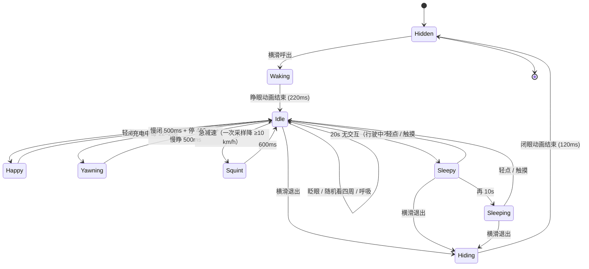
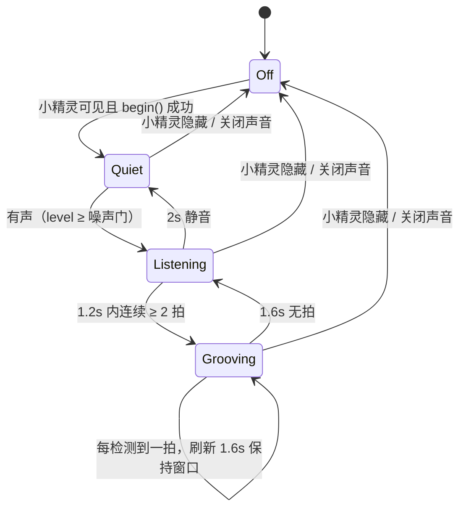

# 离线小精灵 · 设计与实施规划 v0.1

目标硬件：**Waveshare ESP32-S3-Touch-AMOLED-1.75-B**（466×466 圆屏，CST9217 触摸，QMI8658 IMU）。

一句话：**在仪表界面任意页面向左或向右滑动，浮出一只只有两只大眼睛的小精灵；不联网、不说话、不调大模型，纯本地动画；可选开启麦克风，听见环境里的音乐/拍手就跟着律动。**

- 状态：阶段 1–4 已实现（显隐、眨眼/注视/呼吸、触摸追随、开心、困倦/入睡、充电打哈欠、车速瞳孔/急减速眯眼、耳朵/尾巴）；阶段 5「声音律动」已实现，待实机验证
- 关联文档：`design/UI-DESIGN.md`（仪表界面）、`README.md`（固件说明）
- 本文所有坐标均为 LVGL 画面坐标（已按屏幕旋转换算后的坐标）

---

## 1. 目标与非目标

### 1.1 目标

1. **离线**：不依赖 Wi-Fi、BLE、云端、ASR/LLM/TTS，断网、无车、无手机都能玩。
2. **可爱**：两只大眼睛会眨眼、会看人、会跟着手指转、会困；交互反馈在 100ms 内。
3. **不打扰仪表**：默认隐藏，只有用户主动横滑才出现；再横滑退出（默认不超时自动退出）。
4. **成本可控**：新增对象 < 25 个，不新增全屏图层，不新增字体/图片资源，不改 `platformio.ini`。
5. **可回退**：一个 `CFG_ELF_ENABLE` 就能整体关掉；声音功能再用一个 `CFG_ELF_SOUND_ENABLE` 单独关掉。
6. **能听节拍**：小精灵可见时，用板载双麦感知环境音乐/拍手，提取“有没有声音、有多响、节拍多快”，驱动眼睛和身体律动。只做特征提取，不录音、不缓存音频、不上传、不播放声音。
7. **不打扰**：没有声音时完全回到现有行为；睡眠状态下不被环境噪声吵醒；动画幅度有上限，不做全屏闪烁。

### 1.2 非目标（本期不做）

- 语音唤醒、语音对话、联网、大模型（这是“小智”路线，不是本期）。
- 复杂 3D / 精灵身体 / 场景 / 游戏。
- 中文文案：固件没有中文字体，所有界面文字保持 ASCII。
- 音频输出/音效：本期只做麦克风输入，不驱动 ES8311/扬声器，避免 PA 开关、I2S 播放和 BLE/显示抢资源。
- 声源方位识别：双麦可以做到达时间差，但 466 屏上做“转头看声源”收益低、误判多，本期只做节拍与强度。
- 云端曲库/歌曲识别/BPM 标签：没有任何联网路径。

---

## 2. 交互定义

### 2.1 手势表

| 手势 | 仪表页（小精灵隐藏） | 小精灵页（可见） |
| --- | --- | --- |
| **横向滑动**（左或右，\|dx\| ≥ 60px） | **显示小精灵** | **退出，回到仪表** |
| **上/下滑** | 调亮度（保持现状） | 调亮度（保持现状，不抢手势） |
| **轻点**（位移 < 12px） | 无动作 | **摸一下**：开心反应 + 重置交互计时 |
| **长按** | 无动作 | 无动作（保留给后续“抚摸”动效） |
| 触摸移动 | — | 眼睛**追随手指** |

判定沿用现有 `DashboardApp::pollTouch()` 的“主方向”逻辑：

- 纵向领先 → 亮度手势（现有行为，不变）。
- 横向领先（`|dx| > |dy| + 16`）→ 本次按下进入**横向手势**，累计 `dx`。
  - 累计 `|dx| ≥ 60` 且小精灵隐藏 → 显示（每次按下只触发一次）。
  - 累计 `|dx| ≥ 60` 且小精灵可见 → 退出（每次按下只触发一次）。
- **方向不敏感**：左右滑都能呼出，也都能退出。早期实现按“左滑呼出、右滑退出”设计，但实机发现触摸 X 轴与画面方向存在镜像，导致实际是右滑呼出；改成双向后不受镜像影响，对旋转角度也更鲁棒。
- 判定为横向后必须**继续累计 `dx`**，不能提前 `return`。否则慢速滑动永远到不了 60px，表现为“不灵敏、经常无效”（阶段 1 实机问题，已修复）。
- 斜向滑动只归属一个手势，不会同时改亮度又弹出小精灵。
- 坐标已由 `RoundDisplay::mapTouchToScreen()` 换算，所以屏幕转到 90°/180°/270° 时，横向手势始终以用户看到的方向为准。

### 2.2 状态机



> 自动隐藏默认关闭（`CFG_ELF_AUTO_HIDE_MS = 0`）；把该值改成 45000 可恢复“45s 无交互自动退出”。

- **Waking**：眼睛从闭合状态睁开，像刚睡醒，比直接“啪”一下出现更可爱。
- **Sleepy / Sleeping**：眼睑半垂、瞳孔下垂、呼吸变慢；`Sleeping` 时可显示三个低亮度 `z z z`（ASCII）。
- **Happy**：快速眨两下 + 瞳孔放大 + 腮红变亮，持续 600ms。
- **Yawning**：充电时每 12–20s 打一次哈欠：慢闭眼、停一下、慢睁眼，露出嘴。
- **Squint**：急减速时眯眼 600ms，2s 冷却，避免连续减速时反复眯。
- **Hiding**：快速闭眼后隐藏，避免硬切。

### 2.3 边界条件

| 场景 | 处理 |
| --- | --- |
| 开机动画未结束 | 忽略横滑，不显示 |
| 配钥页 / 断连页 / 充电页 | 允许显示（不透明纯黑浮层覆盖，退出后恢复原页） |
| 小精灵可见时车辆数据变化 | **BLE 轮询继续**（照常调用 `m_source.loop()`），仪表重绘暂停；退出后强制重绘一帧，浮层内的车速/充电联动实时生效 |
| 小精灵可见时到自动休眠时间 | 先隐藏小精灵，休眠逻辑照旧（触摸本身已重置静止计时） |
| 触摸芯片初始化失败 | 手势不可用，小精灵永不显示，不影响仪表 |
| 屏幕旋转 | 手势方向跟画面；小精灵本身居中，无需重排 |
| 麦克风/ES7210 初始化失败 | 打印一次 `[AUDIO] init failed`，小精灵其余功能照常，声音子状态保持 `Off` |
| 环境持续安静 | 2s 内无有效声音 → 回到现有 Idle 呼吸/眨眼，不做任何额外动画 |
| 环境很吵但没有节拍（说话、风噪） | 只进入 `Listening`（轻微反应），不进入 `Grooving`，避免“乱抖” |
| 睡眠（Sleepy/Sleeping）时出现声音 | **忽略**，不唤醒；避免夜间环境噪声把设备弄醒 |
| 小精灵隐藏 | 立即停止 I2S，麦克风不工作；再次呼出时重新预热（约 200ms 内出第一帧） |
| 同时有触摸和节拍 | 触摸优先：手指追随/轻点覆盖声音律动，松手 600ms 后声音律动恢复 |

### 2.4 声音子状态（与主状态机正交）

声音不是主状态机的新状态，而是一层**可叠加的“情绪层”**：主状态仍是 `Idle / Happy / Yawning / ...`，声音只决定 `Idle` 时的动画驱动源。这样不会破坏阶段 1–4 已验证的状态迁移。



| 子状态 | 进入条件 | 视觉表现 |
| --- | --- | --- |
| `Off` | 隐藏、关闭声音、初始化失败 | 完全沿用阶段 1–4 |
| `Quiet` | 静音或低于噪声门，持续 2s | 同 `Off`，只保留内部电平估计，不驱动动画 |
| `Listening` | 电平超过噪声门，但节拍置信度不足 | 瞳孔略微放大、腮红随音量轻微变亮、注视方向随机轻移；不跳动 |
| `Grooving` | 1.2s 内 ≥ 2 拍，且 BPM 在 60–200 | 跟随节拍跳动/摇摆/发光/眨眼，幅度与音量、BPM 相关 |

> 声音层只在主状态为 `Idle` / `Blinking` 时生效；`Happy / Yawning / Squint / Sleepy / Sleeping / Hiding` 期间暂停声音动画（但音频特征照常更新，回到 Idle 后立即接上）。

---

## 3. 视觉设计

### 3.1 设计原则

1. **只有眼睛，没有脸。** 黑暗中浮着两只大眼睛，留白越多越像“小精灵”，也越省性能。
2. **配色沿用仪表 token**：冰白眼球、深青虹膜、近黑瞳孔、青色微光，和 `#43D9F5 / #21C15E` 同一套语言。
3. **亮度克制**：AMOLED 纯白很刺眼，眼球用 `#E8F7FF` 而不是 `#FFFFFF`；全局亮度仍受 10%–80% 限制。
4. **不用整屏特效**：不做全屏淡入、全屏缩放、全屏模糊（会生成 466×466 的 ARGB8888 图层，约 868KB，必炸 LVGL 堆）。
5. **静态对象树 + 只改属性**：所有眼睛部件开机建一次，之后只改 `y / height / pos / opa`。

### 3.2 布局（466×466）

```
                        ┌─────────────────────┐
                        │        · 微光弧 ·    │   R210 装饰弧（8% 青）
                        │                     │
                        │   ╭────╮   ╭────╮   │   眼球 128×150
                        │   │ ◉  │   │  ◉ │   │   虹膜 92，瞳孔 74
                        │   ╰────╯   ╰────╯   │   y=133
                        │        (  )          │   嘴 44×14（常态低亮度）
                        │      ·  ·            │   腮红 34×16
                        └─────────────────────┘
```

| 部件 | 尺寸 | 位置（左上角） | 说明 |
| --- | --- | --- | --- |
| 根容器 `m_root` | 466×466 @ (0,0) | — | 不透明纯黑、不可点击、默认隐藏；遮住仪表页 |
| 左眼 `m_eyeL` | 128×150 | (90, 133) | 半径 64（胶囊），中心 (154, 208) |
| 右眼 `m_eyeR` | 128×150 | (248, 133) | 中心 (312, 208) |
| 虹膜 `m_irisL/R` | 92×92 | 眼球内居中 | 深青，随视线偏移 |
| 瞳孔 `m_pupilL/R` | 74×74 | 虹膜内居中 | 近黑 |
| 高光 1 | 26×26 | 瞳孔左上 (−18,−18) | 90% 白 |
| 高光 2 | 12×12 | 瞳孔右下 (+18,+16) | 55% 白 |
| 腮红 `m_blushL/R` | 34×16 | 中心 (120,306) / (346,306) | 圆角胶囊，默认 12% 不透明度 |
| 嘴 `m_mouth` | 44×14 | (211,342) | 常态低亮度，Happy/哈欠时变亮 |
| 装饰弧 `m_aura` | R210，1px | 居中 | 8% 青色，可关 |

> 双眼中心间距 158px，眼间距 30px；整体横向正好居中（90…376，中心 233）。

### 3.3 颜色 Token

| Token | HEX | 用途 |
| --- | --- | --- |
| `ELF_BG` | `#020406` | 根容器不透明底色（AMOLED 黑色像素不发光，同时遮住仪表） |
| `ELF_SCLERA` | `#E8F7FF` | 眼球 |
| `ELF_IRIS` | `#1C4E63` | 虹膜 |
| `ELF_IRIS_RIM` | `#2B7A94` | 虹膜内圈（可选，1px 描边） |
| `ELF_PUPIL` | `#04070A` | 瞳孔 |
| `ELF_GLOW` | `#43D9F5` | 装饰弧 / 高光偏色 |
| `ELF_BLUSH` | `#FF8A80` | 腮红（低不透明度） |
| `ELF_SLEEP` | `#5A6377` | `z z z`、困倦眼皮 |

### 3.4 设计稿（SVG，可缩放查看）

<svg width="466" height="466" viewBox="0 0 466 466" xmlns="http://www.w3.org/2000/svg">
  <defs>
    <radialGradient id="bg" cx="50%" cy="42%" r="60%">
      <stop offset="0%" stop-color="#0B141B"/>
      <stop offset="100%" stop-color="#020406"/>
    </radialGradient>
  </defs>
  <circle cx="233" cy="233" r="233" fill="url(#bg)"/>
  <circle cx="233" cy="233" r="210" fill="none" stroke="#43D9F5" stroke-opacity="0.08" stroke-width="1"/>
  <!-- 左眼 -->
  <rect x="90" y="133" width="128" height="150" rx="64" fill="#E8F7FF"/>
  <circle cx="154" cy="208" r="46" fill="#1C4E63"/>
  <circle cx="154" cy="208" r="37" fill="#04070A"/>
  <circle cx="136" cy="190" r="13" fill="#FFFFFF" fill-opacity="0.9"/>
  <circle cx="172" cy="224" r="6" fill="#FFFFFF" fill-opacity="0.55"/>
  <!-- 右眼 -->
  <rect x="248" y="133" width="128" height="150" rx="64" fill="#E8F7FF"/>
  <circle cx="312" cy="208" r="46" fill="#1C4E63"/>
  <circle cx="312" cy="208" r="37" fill="#04070A"/>
  <circle cx="294" cy="190" r="13" fill="#FFFFFF" fill-opacity="0.9"/>
  <circle cx="330" cy="224" r="6" fill="#FFFFFF" fill-opacity="0.55"/>
  <!-- 腮红 / 嘴 -->
  <rect x="103" y="298" width="34" height="16" rx="8" fill="#FF8A80" fill-opacity="0.12"/>
  <rect x="329" y="298" width="34" height="16" rx="8" fill="#FF8A80" fill-opacity="0.12"/>
  <rect x="211" y="342" width="44" height="14" rx="7" fill="#5A6377" fill-opacity="0.3"/>
</svg>

> SVG 里嘴和腮红只是为了预览构图；固件里嘴常态低亮度、腮红低亮度，Happy/哈欠时变亮。

---

## 4. 动画设计

所有动画都只改**小对象的几何/透明度**，单帧重绘面积 < 130×150，不触发全屏重绘。

| 动画 | 触发 | 参数 | 实现 |
| --- | --- | --- | --- |
| **睁眼（Waking）** | 横滑呼出 | 高度 10 → 150，220ms，ease_out | `lv_anim` 改 `height` + `y` |
| **闭眼（Hiding）** | 横滑退出 / 超时 | 高度 150 → 10，120ms，ease_in | 同上，结束后 `lv_obj_add_flag(HIDDEN)` |
| **眨眼** | 随机 2.4–6.0s | 闭 90ms / 停 40ms / 睁 140ms；20% 概率连眨两下 | 三段 `lv_anim` 或状态机计时 |
| **随机注视** | 随机 2.5–5.0s | 目标 x ±30、y ±22，350ms ease_out；身体同时左右 ±10 | `lv_anim` 改虹膜 `x/y` + 身体 `x` |
| **追随手指** | 触摸移动 | 目标 = 手指位置换算的偏移（±30 / ±22），身体左右 ±10；80ms 跟随 | 直接 `lv_obj_set_pos()`，不做动画 |
| **呼吸** | 常驻（可见时） | 身体容器 y ±22px，周期 6s，ease_in_out | `lv_anim` repeat_infinite，兼做防烧屏漂移；黑底与装饰弧不动 |
| **开心（Happy）** | 轻点 | 连眨 2 次 + 瞳孔 74→82 + 腮红 12%→30%，600ms | 组合动画 |
| **困倦（Sleepy）** | 20s 无交互且未行驶 | 眼高 150 → 86，瞳孔下移 +8，呼吸周期 6s→9s | 状态切换 + 慢动画 |
| **入睡（Sleeping）** | 再 10s | 眼高 → 46，显示 `z z z` 呼吸闪烁 | `lv_label` 三个字符，250ms 周期 |
| **打哈欠（Yawning）** | 充电中每 12–20s | 慢闭 500ms / 停 400ms / 慢睁 500ms，露出嘴 | 状态切换 + 三段 `lv_anim` |
| **车速瞳孔** | 车速 20–100 km/h | 瞳孔 74 → 86，300ms ease_out | `lv_anim` 改瞳孔尺寸；Happy 结束后回到当前基准 |
| **急减速眯眼（Squint）** | 一次采样降 ≥10 km/h | 眼高 → 62，眯 600ms，2s 冷却 | 状态切换 + `lv_anim` |
| **自动隐藏** | 默认关闭（`CFG_ELF_AUTO_HIDE_MS=0`） | 走 Hiding | 内部 `lv_timer` 计时；设为 45000 可恢复 |

### 4.1 眨眼细节（关键可爱点）

- 闭眼时 **高度压缩、中心不变**：`y = 208 − h/2`，所以是“眼皮合上”而不是“眼睛掉下去”。
- 子对象（虹膜/瞳孔/高光）由父对象裁剪，高度变小时自然被“吃掉”，不需要逐个隐藏。
- 睁眼比闭眼慢（140ms vs 90ms），符合真实眨眼节奏。
- 20% 概率连眨两下，避免机械感。

### 4.2 视线与“灵魂”

- 空闲时视线不是死盯正前方，而是每 2.5–5s 随机看向左/右/上/下（±30 / ±22），身体跟着左右轻晃 ±10px，停留 0.8–1.5s。
- 触摸时立刻看向手指（眼睛在屏幕内的相对位置），松手后 600ms 回到随机游走。
- 轻点后眼睛看向手指 300ms 再回正，形成“被摸到”的反馈。

### 4.3 声音律动动画（阶段 5）

> 原则：**一拍只改几个属性，不新建动画对象。** 拍点很密（120 BPM = 每 500ms 一下），如果每一拍都 `lv_anim_start()`，动画句柄会频繁创建/销毁。声音律动统一用**一个衰减包络**驱动，定时器每 30ms 读取一次。

记：

- `level`：0–255 的对数音量（已做噪声门与平滑）。
- `g`：律动强度 0–1，`g = max(level/255, bpm 权重)`，并做上限钳制。
- `pulse`：拍点包络，检测到拍瞬间置 1，之后按 `exp(-t/120ms)` 衰减。

| 动画 | 触发/驱动 | 参数 | 实现（只改属性） |
| --- | --- | --- | --- |
| **节拍弹跳** | 每拍 `pulse` | 身体 y 偏移 `- (4 + 16g) * pulse`，最大行程 20px | 30ms 定时器直接 `lv_obj_set_y(m_body, ...)` |
| **左右摇摆** | Grooving 常驻 | 身体 x `± (4 + 8g) * sin(2π · beatPhase)`；每拍换向 | 直接改 `x`，与弹跳叠加 |
| **开心眼** | 每拍 | 眼睛高度 `150 + (4 + 6g) * pulse`，中心不变（`y = 208 - h/2`） | 直接改 `height/y` |
| **瞳孔呼吸** | level / 每拍 | 瞳孔基准 `74 + 6g`，拍点再 `+4 * pulse`；上限 90 | 直接改 `size`，与车速瞳孔统一取最大值 |
| **腮红变亮** | level | 不透明度 `12% + 20% * level/255` | 直接改 `bg_opa` |
| **嘴型张开** | level | 高度 `14 + 10 * level/255`（最大 24） | 直接改 `height`（圆角不变） |
| **耳朵/尾巴** | 每拍 | 左右耳交替弹起；尾巴按低频能量伸缩并做波浪摆动 | 直接改 `x/y/size`，不新增对象 |
| **彩色泡泡** | Grooving 每拍 | 直径翻倍为 14–30px，每拍喷出 4 个不同颜色/大小泡泡，16 个对象循环复用；从身体两侧上浮约 84px、漂移并淡出 | 预创建对象，由 30ms 声音定时器更新 |
| **音乐变色** | 音量 / 拍点 | 光环随音量由青蓝渐变至紫红，Grooving 时按拍轮换色相；耳朵/尾巴同步染色 | HSV 转色后直接改颜色属性 |
| **光环呼吸** | 常驻 + 声音 | 安静时以 3.2s 周期在 8%–11% 缓慢呼吸；音乐时叠加节拍亮度，最高 30% | 直接改 `border_opa` |
| **节拍眨眼** | 每 4 拍 | 快速单眨一次（闭 70ms / 睁 110ms） | 复用现有眨眼状态机 |
| **高潮反应** | 每 8 拍或 BPM > 150 | 连眨两下 + 身体弹跳幅度 ×1.3 | 复用现有 Happy/连眨 |
| **停止律动** | Grooving → Listening | 500ms 内把上述偏移平滑归零，恢复呼吸与随机注视 | 定时器插值，不硬切 |

**幅度分级**（避免所有歌看起来一样）：

| 条件 | `g` | 表现 |
| --- | --- | --- |
| `level < 噪声门` | 0 | 身体保持呼吸，光环缓慢脉动 |
| 轻声/说话 | 0.2–0.4 | 只眨眼、腮红微亮、眼睛轻微跟随 |
| 正常音乐 | 0.4–0.7 | 弹跳 + 摇摆 + 瞳孔变化 |
| 大声/快歌（BPM ≥ 140 或 level ≥ 200） | 0.7–1.0 | 加耳朵/尾巴、8 拍高潮、弹跳上限 |

**冲突处理（关键）**：

1. 呼吸动画和节拍弹跳都改 `m_body.y`。进入 Grooving 时先 `stopBreathing()`，退出后重新 `startBreathing()`；否则两个动画会互相抢属性。
2. 车速瞳孔、Happy 瞳孔、声音瞳孔都改瞳孔大小。改为**单一目标值函数** `updatePupilTarget()`：先取车速/Happy 的基准，再叠加声音偏移并钳制上限，禁止多个 `lv_anim` 同时写同一个对象。
3. 声音律动期间暂停“随机注视”，改用节拍换向的视线；触摸仍然最高优先级。
4. 不做全屏透明度/缩放，不做高于 3Hz 的亮度闪动；`pulse` 是衰减包络，不是方波闪烁，减少视觉疲劳和 AMOLED 烧屏风险。

---

## 5. 技术方案

### 5.1 模块划分

新增一个独立 UI 组件，不往 `LvglDashboard` 里塞逻辑：

```text
include/ui/ElfOverlay.h        # 对外接口
src/ui/ElfOverlay.cpp          # 对象树 + 动画状态机 + 内部 lv_timer

include/audio/SoundSensor.h    # 声音感知对外接口（阶段 5）
src/audio/SoundSensor.cpp      # ES7210 + I2S TDM + 特征提取任务
```

```cpp
class ElfOverlay {
 public:
  void begin();                    // 在 active screen 上建对象，默认隐藏
  bool visible() const;
  void show();                     // 横滑呼出；Waking 动画
  void hide();                     // 横滑退出/超时；Hiding 动画
  void lookAt(int16_t screenX, int16_t screenY);  // 触摸移动
  void touchEnd();                                 // 松手：600ms 后回到随机注视
  void poke(int16_t screenX, int16_t screenY);    // 轻点
  void setVehicleState(float speedKmh, bool speedValid, bool charging);
                                                   // 阶段 4：实时车辆状态
  void tick(uint32_t nowMs);       // 可选：若不用内部 lv_timer
 private:
  // 对象指针 + 状态机 + 计时
};
```

推荐**内部自带一个 50ms 的 `lv_timer`** 做状态机（眨眼调度、困倦、自动隐藏），`DashboardApp` 只负责手势和转发触摸坐标。理由：`display.loop()` 里已经统一跑 `lv_timer_handler()`，不需要在 `DashboardApp::loop()` 再加一套时间判断。

阶段 5 再增加一个独立的声音模块，ElfOverlay 只消费特征，不碰 I2S：

```cpp
// 音频线程发布的最新一帧特征（只读快照，不包含任何原始采样）。
struct SoundFrame {
  uint8_t level;        // 0–255 对数音量（已做噪声门/平滑）
  uint8_t low;          // 0–255 低频（40–180Hz）能量，用于节拍
  uint8_t bpm;          // 0 = 未知，60–200
  uint8_t confidence;   // 0–255 BPM 置信度
  uint8_t beatCount;    // 累计拍数，用来判断“这一帧有没有新拍”
  bool beat;            // 自上次 read() 起是否出现过新拍（读取即清）
  bool loud;            // 是否超过噪声门
};

class SoundSensor {
 public:
  bool begin();                 // 初始化 I2C/ES7210/I2S；失败返回 false
  bool start();                 // 小精灵显示时启动采集任务
  void stop();                  // 小精灵隐藏时停止并释放 DMA
  bool running() const;
  SoundFrame read();            // 主线程读取最新快照
  bool available() const;       // begin() 是否成功
};
```

约定：

- 音频采集和特征计算跑在**独立 FreeRTOS 任务**（core 1，优先级 2，栈 4KB），每 16ms 读一块 I2S 数据；
- 任务只写一个 `SoundFrame` 快照（临界区/双缓冲），LVGL 定时器只读快照，**绝不在音频任务里调用 LVGL**；
- `read()` 返回后清掉一次性 `beat` 标志，避免每个 30ms tick 重复触发弹跳。

### 5.2 与现有代码的接入点

| 文件 | 改动 |
| --- | --- |
| `include/app/DashboardApp.h` | 增加 `#include "ui/ElfOverlay.h"`、成员 `ElfOverlay m_elf;`、横向手势状态 `m_elfSwipeLatched`、`m_touchMaxTravel`；阶段 5 增加 `#include "audio/SoundSensor.h"`、成员 `SoundSensor m_sound;` |
| `src/app/DashboardApp.cpp` | `begin()` 里 `dashboard.begin()` 之后调用 `m_elf.begin()`（保证浮层在开机图层之上）；`pollTouch()` 增加横向累计与显隐/轻点判定（按下/移动转发 `lookAt`、松手转发 `touchEnd`）；`loop()` 里小精灵可见时**只暂停仪表重绘、BLE 轮询保持**，并在可见性下降沿强制补画一帧；每轮调用 `m_elf.setVehicleState(...)` 传递实时车速/充电状态；阶段 5 在 `m_elf.show()` 后 `m_sound.start()`、`hide()` 完成或可见性下降沿 `m_sound.stop()`，并每轮把 `m_sound.read()` 喂给 `m_elf.setSoundFrame(...)` |
| `include/audio/SoundSensor.h` | 新增：I2S/ES7210 初始化、采集任务、节拍/BPM 特征输出 |
| `src/audio/SoundSensor.cpp` | 新增：ES7210 寄存器初始化 + `driver/i2s_tdm.h` 接收 + 能量/鼓点分析 |
| `include/ui/ElfOverlay.h` | 新增 `setSoundFrame(const SoundFrame&)`、声音子状态、包络变量、`updatePupilTarget()` |
| `src/ui/ElfOverlay.cpp` | 新增 `applySoundVisuals()`，30ms 声音动画 tick；Grooving 时平滑接管呼吸、驱动 body/pupil；退出后恢复 |
| `include/config.h` | 新增 `CFG_ELF_*` 开关与阈值、`CFG_ELF_SOUND_*` 参数 |
| `README.md` | 增加一节“离线小精灵”与本文链接（可选，建议加） |

**不改** `platformio.ini`、`lv_conf.h`、显示驱动、BLE 后端、`RoundDisplay`/`LvglDashboard`。

> I2S 驱动使用 Arduino-ESP32 已内置的 ESP-IDF 组件（`driver/i2s_tdm.h`），不需要在 `platformio.ini` 增加依赖。ES7210 没有现成库，采用**最小寄存器初始化表**（从微雪 BSP / 06_ES7210 示例移植），避免为了一个麦克风引入 `esp_codec_dev` 整棵依赖树。

### 5.3 手势接入伪代码

```cpp
// pollTouch()，按下后的移动阶段
const int32_t dx = rawX - m_touchStartX;
const int32_t dy = rawY - m_touchStartY;

// 小精灵可见时：触摸移动 = 视线跟随
if (m_elf.visible()) {
  m_elf.lookAt(rawX, rawY);
}

// 已进入亮度手势
if (m_swipeActive) { ...调亮度...; return; }

// 纵向领先 → 亮度手势
if (!m_touchHorizontal && abs(dy) >= kSwipeActivatePx &&
    abs(dy) > abs(dx) + kSwipeDominancePx) {
  m_swipeActive = true;
  ...记录锚点...
  return;
}

// 横向领先 → 进入横向手势，但不要 return，后面还要继续累计 dx
if (!m_touchHorizontal && abs(dx) > abs(dy) + kSwipeDominancePx) {
  m_touchHorizontal = true;
}
if (!m_touchHorizontal || m_elfSwipeLatched) {
  return;
}

// 方向不敏感：隐藏时左右滑都呼出，显示时左右滑都退出
if (abs(dx) >= CFG_ELF_SWIPE_PX) {
  if (!m_elf.visible()) {
    if (!dashboard.bootAnimationRunning()) m_elf.show();
  } else {
    m_elf.hide();
    m_hasRenderedModel = false;  // 退出后强制补画一帧
  }
  m_elfSwipeLatched = true;      // 每次按下只触发一次
}
```

释放时（`!pressed` 分支）：

```cpp
if (m_touchDown) {
  const int32_t travel = max(abs(m_touchLastX - m_touchStartX),
                             abs(m_touchLastY - m_touchStartY));
  if (m_elf.visible() && travel < CFG_ELF_TAP_PX) {
    m_elf.poke(m_touchLastX, m_touchLastY);
  }
  ...
}
```

### 5.4 渲染抑制与轮询策略

```cpp
// DashboardApp::loop()
#if !CFG_DEMO_MODE
if (m_sourceStarted) {
  m_source.loop();          // 小精灵显示期间仍保持 BLE 轮询（阶段 4 需要实时数据）
  m_model = m_source.model();
}
#endif

if (!dashboard.bootAnimationRunning() && !m_elf.visible() &&
    now - m_lastRenderMs >= 50) {
  ...
}

#if CFG_ELF_SOUND_ENABLE
if (m_elf.visible()) {
  m_elf.setSoundFrame(m_sound.read());  // 无锁快照，小精灵内部再消费
}
#endif
```

- **小精灵可见期间保持数据轮询**：`m_source.loop()` 照常调用，`UiModel` 持续更新，充电打哈欠、车速瞳孔、急减速眯眼才能实时联动。
- **只暂停仪表重绘**（`!m_elf.visible()`），避免浮层后面的仪表白白刷屏。
- `hide()` 完成后强制 `m_hasRenderedModel = false;`，下一轮一定重画一帧，退出后仪表立刻显示最新数据。
- **声音采集只跟随可见性**：`show()` 成功启动后 `m_sound.start()`；可见性下降沿（含 Hiding 动画结束）`m_sound.stop()`。不要在 `loop()` 里每帧 start/stop。

### 5.5 LVGL / 性能注意事项（本项目踩过的坑）

1. **禁止整屏 `transform_scale` / `opa` 动画**：会为根对象分配 466×466 ARGB8888 图层（≈868KB），直接打爆 LVGL 堆（`makeScaledLabel` 注释里已记录过一次 `StoreProhibited`）。
2. **眨眼不要用缩放**：LVGL 9 的 `transform_scale` 是等比缩放，压不扁眼睛；用 `height + y` 才能做出“合眼”。
3. **不要用 `lv_obj_set_style_shadow_*` 做柔光**：软件阴影在 466 屏上很贵；用“大一圈、低透明度的同色圆”代替。
4. **对象数控制在 25 个以内**，`m_root` 不透明纯黑（`#020406`）、无边框、不可点击、不可滚动。
5. **不新增字体/图片**：`z z z` 用内置 `montserrat_28`，眼睛全部用 `lv_obj` 几何图形。
6. **防烧屏**：呼吸动画让眼睛整体漂移 ±22px；自动隐藏默认关闭，长时间停留时靠呼吸漂移；亮度上限仍由 `RoundDisplay` 钳在 80%。
7. **浮层顺序**：`m_elf.begin()` 必须在 `dashboard.begin()` 之后，否则会被开机图层盖住；`show()` 里可再 `lv_obj_move_foreground(m_root)` 保险。
8. **AMOLED 纯白**：眼球用 `#E8F7FF`，并把高光不透明度控制在 90% 以内。
9. **横滑要持续累计位移**：判定为横向手势后仍要在每次 `pollTouch()` 里更新 `dx`，不能提前退出函数。阶段 1 实机出现过慢速横滑无效，就是这个原因。
10. **不要依赖左右方向**：触摸 X 轴与画面存在镜像可能，横滑显隐按 `|dx|` 判断，左右都能呼出/退出。
11. **音频任务不碰 LVGL**：I2S 任务里只能改 `SoundFrame` 快照；LVGL 只能在 `lv_timer`/主任务里改。跨线程直接 `lv_obj_set_*` 会偶发花屏/死机。
12. **拍点包络代替逐拍动画**：120 BPM 下每 500ms 一个 `lv_anim` 虽然能跑，但会和呼吸、注视、瞳孔动画抢同一属性。统一用一个 `pulse` 变量 + 30ms tick。
13. **呼吸/弹跳互斥**：进入 Grooving 必须 `stopBreathing()`，退出再恢复；否则 `m_body.y` 被两个动画同时写。
14. **瞳孔只允许一个写入者**：车速、Happy、声音三者叠加后统一写一次，避免动画“打架”导致瞳孔抖动。
15. **麦克风只在可见时开**：隐藏后必须 `i2s_channel_disable` + 停任务，否则白耗电，也会让用户担心隐私。
16. **不要用 FFT 做第一版**：16kHz 下 512 点 FFT 当然能跑，但第一版只需要低频能量和鼓点，用 DC 阻断 + 二阶低通 + 能量包络就够，CPU 和代码复杂度都低一个量级。
17. **不要在 MCU 上做 AGC 过度补偿**：自动增益会把安静时的底噪也放大，导致小精灵在无声环境乱跳；只做固定增益 + 噪声门。
18. **ES7210 模拟供电**：板上 codec 模拟电源由 AXP2101 ALDO1（A3V3）提供。若读到的采样恒为 0，先确认 ALDO1 已开启，再查 MCLK/BCLK/LRCK/DIN 和 ES7210 寄存器，不要盲目改算法。
19. **MCLK 引脚以当前 BSP 为准**：硬件参考里 MCLK = GPIO42（不是 GPIO16）。论坛上有人照旧原理图接 GPIO16 导致全 0，已确认 GPIO42 可用。

### 5.6 配置项（`include/config.h`）

```cpp
// 离线小精灵
#define CFG_ELF_ENABLE 1                 // 0 = 完全关闭（不建对象、不响应手势）
#define CFG_ELF_SWIPE_PX 60              // 横向滑动触发距离
#define CFG_ELF_DOMINANCE_PX 16          // 横向需领先纵向的幅度（与亮度手势共用）
#define CFG_ELF_TAP_PX 12                // 位移小于此值算轻点
#define CFG_ELF_AUTO_HIDE_MS 0UL         // 无交互自动隐藏；0 = 常亮
#define CFG_ELF_SLEEP_MS 20000UL         // 进入困倦
#define CFG_ELF_SLEEP_DEEP_MS 30000UL    // 进入睡眠
#define CFG_ELF_BLINK_MIN_MS 2400UL
#define CFG_ELF_BLINK_MAX_MS 6000UL
#define CFG_ELF_GAZE_MIN_MS 2500UL
#define CFG_ELF_GAZE_MAX_MS 5000UL

// 阶段 5：声音律动
#define CFG_ELF_SOUND_ENABLE 1           // 0 = 不初始化麦克风，完全沿用阶段 1–4
#define CFG_ELF_SOUND_SAMPLE_RATE 16000  // ES7210 采样率
#define CFG_ELF_SOUND_HOP_MS 16          // 特征帧移（分析窗口 32ms）
#define CFG_ELF_SOUND_NOISE_GATE 8       // level 低于此值视为静音（0–255）
#define CFG_ELF_SOUND_QUIET_MS 2000UL    // 静音多久回 Quiet
#define CFG_ELF_SOUND_BEAT_MIN_BPM 60    // 有效节拍范围
#define CFG_ELF_SOUND_BEAT_MAX_BPM 200
#define CFG_ELF_SOUND_BEAT_REFRACTORY_MS 200UL  // 两拍最小间隔
#define CFG_ELF_SOUND_BEAT_CONFIRM 2     // 1.2s 内至少几拍才进 Grooving
#define CFG_ELF_SOUND_MIN_CONFIDENCE 80  // 进入 Grooving 的最低节拍置信度（0–255）
#define CFG_ELF_SOUND_ONSET_THRESHOLD 0.45f  // 节拍起音阈值；越低越灵敏
#define CFG_ELF_SOUND_GROOVE_HOLD_MS 1600UL     // 无拍后保持律动的时间
#define CFG_ELF_SOUND_BOUNCE_PX 20       // 弹跳最大行程
#define CFG_ELF_SOUND_SWAY_PX 12         // 摇摆最大行程
#define CFG_ELF_SOUND_LEVEL_GAIN 6       // ES7210 输入增益档位（比原设置提高约 6dB）
#define CFG_ELF_SOUND_LOG 0              // 1 = 每 500ms 打印 level/bpm/conf
```

### 5.7 内存与帧率预算

| 项 | 估算 |
| --- | --- |
| LVGL 对象 | ~24 个（含 2 眼 × 5 部件 + 腮红/嘴/弧/2 耳/3 尾/3 z） |
| 对象内存 | < 6KB |
| 动画 | 同时最多 3 个（呼吸 + 眨眼 + 视线）；声音律动不新增 `lv_anim` |
| 单帧重绘 | < 32K px（约 15% 屏），远低于仪表整屏刷新 |
| 额外 PSRAM | 0（不用 canvas / 图片） |
| 预期帧率影响 | 可忽略；BLE 轮询不受影响 |
| 声音：I2S DMA | 4 个描述符 × 256 帧 × 8B ≈ 8KB（16kHz、16bit、4 时隙） |
| 声音：分析缓冲 | 512 点环形缓冲 + 特征状态 < 2KB（内部 RAM） |
| 声音：任务栈 | 4KB（core 1，优先级 2） |
| 声音：CPU | 约 2–4%（16kHz，DC 阻断 + 2 个低通 + RMS，无 FFT） |
| 声音：额外对象 | **0 个**（复用眼睛/身体/腮红/嘴/耳朵/尾巴/光环） |

### 5.8 音频硬件与驱动

**硬件（已核对官方硬件参考）**：

| 信号 | GPIO | 说明 |
| --- | ---: | --- |
| MCLK | 42 | ES8311 / ES7210 共用主时钟 |
| BCLK | 9 | 位时钟 |
| LRCK / WS | 45 | 帧时钟 |
| DIN（采集） | 10 | ES7210 → ESP32-S3 |
| DOUT（播放） | 8 | 本期不使用 |
| PA_CTRL | 46 | 本期不驱动，保持关闭 |
| ES7210 I2C | 0x40 | 与触摸/IMU/PWR 键共用 14/15 总线 |
| 麦克风 | MIC1 / MIC2 | 两个板载前置麦；MIC3 是 ES8311 播放参考（本期不用），MIC4 未接 |

**初始化顺序**（`SoundSensor::begin()`）：

1. `Wire` 已由 `DashboardApp` 启动（触摸/PWR 键共用），直接复用，不重复 `Wire.begin()`。
2. 复位/唤醒 ES7210（软复位 + 上电序列），写最小寄存器表：**从模式**（I2S 主控是 ESP32-S3）、16kHz、16bit、TDM 4 时隙、MIC1/MIC2 使能、增益 `CFG_ELF_SOUND_LEVEL_GAIN`。
3. 配置 I2S RX 为 TDM 模式：
   - `i2s_new_channel()` 只建 RX（`tx_handle = nullptr`），角色 master；
   - 时钟：16kHz、MCLK ×256、BCLK = 64×fs；
   - 槽位：4 × 16bit（`I2S_TDM_SLOT0..3`），每帧 8 字节；
   - `auto_clear = true`，DMA 4 个描述符，每个 256 帧（约 16ms）。
4. `i2s_channel_enable()` 后先丢弃前 8 帧（约 130ms），等 ES7210 高通/偏置稳定，再开始发布特征。
5. 任一步失败 → 释放已申请资源，返回 `false`；上层只打印一次日志，不重试、不影响小精灵。

**声道选择**：TDM 四时隙顺序是 MIC1、MIC3（参考）、MIC2、MIC4。取 **slot0（MIC1）与 slot2（MIC2）**，两路相加/取较大者，抑制单麦被手指或外壳挡住导致的漏检。

**供电注意**：codec 模拟电源来自 AXP2101 的 ALDO1（A3V3）。当前工程没有 AXP2101 驱动；若 `begin()` 成功但采样恒为 0，按以下顺序排查：

1. 用示波器/逻辑分析仪确认 GPIO42/9/45 有时钟、GPIO10 有数据；
2. 读 ES7210 寄存器确认未静音、增益正确；
3. 必要时通过 I2C `0x34` 写 AXP2101，打开 ALDO1 3.3V（只写电源寄存器，不引入完整电源驱动）；
4. 以上都正常仍为 0，再检查焊接/麦克风孔是否被外壳堵住。

### 5.9 节拍分析算法（第一版，无 FFT）

目标不是“识别歌曲”，而是**稳定地知道现在有没有拍子、多快、多响**。采样率 16kHz、窗口 32ms（512 点）、帧移 16ms。

```text
I2S TDM 4ch ──取 slot0/2 平均──► DC 阻断 ──► 低通(180Hz)×2 ──► 低频能量
                                   │
                                   └──► 全带 RMS ──► level（对数 + 平滑）
低频能量序列 ──► 与 1.5s 慢速基线比较 ──► onset 强度
onset 序列 ──► 局部峰值 + 200ms 不应期 ──► 拍点
拍点间隔 ──► 中位数 + 平滑 ──► BPM / confidence
```

1. **DC 阻断**：`y[n] = x[n] - x[n-1] + 0.995 * y[n-1]`，去掉麦克风偏置和低频漂移。
2. **低频能量**：两级一阶低通（截止约 180Hz）后求均方；只关心底鼓/贝斯/拍手的主要能量。
3. **全带电平**：去 DC 后的 RMS → `20log10` → 映射到 0–255；再做 200ms 慢速平滑，作为 `level`。
4. **Onset**：
   - 基线 `baseline` 用 1.5s 慢速 EMA；
   - `onset = max(0, lowEnergy / (baseline + ε) - 1)`；
   - 只有 `level > 噪声门` 且 `onset > CFG_ELF_SOUND_ONSET_THRESHOLD` 才候选。
5. **峰值确认 + 不应期**：
   - 候选值必须大于前一帧与后一帧（延迟 1 帧确认，16ms）；
   - 距上一拍 < 200ms 的候选丢弃（对应最高 300 BPM，覆盖快歌）；
   - 连续 3 拍间隔稳定（±25%）才把 `confidence` 拉高。
6. **BPM**：
   - 取最近 8 个有效 IOI 的中位数 → `60000 / ioi`；
   - 折叠到 60–200（例如 240 → 120，避免把八分音符当主拍）；
   - 与上一值相差 < 8% 时平滑跟随，否则 1s 后再切换，避免显示值乱跳。
7. **静音判定**：`level < CFG_ELF_SOUND_NOISE_GATE` 持续 2s → `Quiet`，`bpm = 0`。
8. **可选增强（第二阶段再做）**：3 段 Goertzel（低/中/高）驱动尾巴三颗圆点做电平表；双麦时延差做左右声源（本期不做）。

**为什么不用 FFT**：第一版只需要低频能量包络；512 点 FFT 每 16ms 一次在 S3 上也能跑，但会引入复数运算、窗函数和频谱峰值挑选，调参成本高。等节拍稳定后，再按需加 Goertzel 频段。

### 5.10 数据流与线程模型

```text
core 1: SoundSensor task (16ms)
  I2S read → 特征计算 → 写 SoundFrame 快照（portMUX 临界区，<10µs）
        │
        ▼
主任务: DashboardApp::loop()
  m_elf.setSoundFrame(m_sound.read());   // 只拷贝 8 字节，无锁等待
        │
        ▼
LVGL thread: ElfOverlay 30ms lv_timer
  读 m_soundFrame → 更新 pulse / groove 包络 → 只改小对象属性
```

- `SoundSensor::read()` 使用双缓冲 + 序号（seqlock）或 `portMUX_TYPE`，主任务绝不阻塞等待 I2S。
- `beat` 是一次性标志：`read()` 读取后清零，ElfOverlay 在同一 tick 内消费。
- 音频任务优先级低于 BLE/LVGL 主循环，避免抢占导致掉帧；栈 4KB，看门狗喂狗由主循环负责。

### 5.11 调试与调参

| 手段 | 说明 |
| --- | --- |
| `CFG_ELF_SOUND_LOG = 1` | 每 500ms 打印 `[AUDIO] lvl=... low=... bpm=... conf=... beat=...`；状态切换另有 `[ELF] sound ...` |
| 静音基线 | 上电后 3s 内不触发节拍，只记录环境底噪；日志里 `lvl` 应稳定在 0–8 |
| 节拍器 | 手机播放 60/90/120/150 BPM，确认 `bpm` 在 ±5 内、`beat` 与声音同步 |
| 拍手 | 单次拍手应只产生 1 拍；连续拍手 8 次应进入 Grooving |
| 音乐 | 低音明显的歌优先；只有人声/高频的歌允许只进 `Listening` |
| 误触发 | 敲桌子/触摸屏幕不应连续触发；必要时提高 `NOISE_GATE` 或 `onset` 阈值 |
| 延迟 | 拍点到画面变化目标 < 100ms（分析 16–32ms + 定时器 ≤30ms） |

---

## 6. 实施计划

### 阶段 1：能出来（已完成代码，待实机验证）

- [x] 新建 `ElfOverlay`，画静态双眼（眼球 + 虹膜 + 瞳孔 + 高光）。
- [x] `DashboardApp` 横向手势：左/右滑显示、再横滑隐藏，串口打印 `[ELF] show/hide`。
- [x] 小精灵可见时跳过仪表重绘，退出时强制重绘一帧。
- [x] 小精灵可见时保持 BLE 数据轮询，只暂停仪表重绘。
- [x] 根容器改为不透明纯黑，呼出时完全盖住仪表页。
- [ ] 验证 0°/90°/180°/270° 四个方向手势一致。

> 阶段 1 实机反馈：① 原“左滑呼出/右滑退出”受触摸 X 轴镜像影响，实际表现为右滑呼出，已改为方向不敏感；② 横向判定后提前 `return` 导致 `dx` 不再累计，慢滑经常无效，已修复。

### 阶段 2：活起来（已完成代码，待实机验证）

- [x] 睁眼/闭眼过渡（睁眼 220ms ease_out，闭眼 120ms ease_in）。
- [x] 随机眨眼（闭 90ms / 停 40ms / 睁 140ms，20% 概率连眨，第二下后恢复正常间隔）。
- [x] 随机注视（±30 / ±22，350ms ease_out，2.5–5.0s 一次，身体左右 ±10）+ 呼吸漂移（身体容器 y +22 ↔ −22，6s 循环，黑底与装饰弧保持不动）。
- [x] 串口日志：`[ELF] blink` / `[ELF] blink x2` / `[ELF] gaze -> (x,y)`。

> 实现要点：眨眼用 `height + y`，中心固定在 y=208；所有动画只改眼睛/虹膜/根容器的几何属性。状态机 `Hidden → Waking → Idle → Blinking / Hiding`，由 50ms `lv_timer` 调度，`hide()` 期间 `visible()` 仍为 true，等闭眼动画结束才真正隐藏，避免硬切。

### 阶段 3：有性格（已完成代码，待实机验证）

- [x] 触摸追随 + 轻点开心反应。
- [x] 困倦/入睡状态 + `z z z`。
- [x] 20s/30s 计时；45s 自动隐藏改为默认关闭（`CFG_ELF_AUTO_HIDE_MS = 0`，可改回 45000）。
- [ ] 配钥页、断连页、充电页上的浮层回归测试。

> 实现要点：
> - 触摸移动直接改虹膜 `x/y` 和身体 `x`（左/右各 ±10），不做动画；松手后 600ms 恢复随机注视。
> - 轻点（位移 < 12px）触发 Happy：眼睛 150→10→150 快眨两次（`reverse` + `repeat_count=2`），瞳孔 74→82，腮红 12%→30%，600ms 后恢复。
> - 20s 无交互 → Sleepy（眼高 86、瞳孔下移 8、呼吸周期 9s）；再过 10s → Sleeping（眼高 46，显示三个低亮度 `z`，整体不透明度错峰呼吸，串口打印 `[ELF] zzz on`）。
> - 任何触摸/轻点都会重置交互计时，并从 Sleepy/Sleeping 唤醒回 Idle。
> - 自动隐藏由 `ElfOverlay` 内部定时器触发（默认关闭）；`DashboardApp` 检测可见性下降沿后强制补画一帧。

### 阶段 4：车辆联动与轮廓（已完成代码，待实机验证）

- [x] 充电时自动打哈欠（本地读 `UiModel.charging`，仍不联网）。
- [x] 车速高时瞳孔放大、急减速时眯眼（本地数据驱动）。
- [x] 精灵耳朵/小尾巴等轮廓装饰（低对比度，避免抢眼睛）。
- [x] 去除 45s 自动退出（默认常亮）。

> 实现要点：
> - `DashboardApp::loop()` 每轮调用 `setVehicleState(m_model.speedKmh, m_model.speedValid, m_model.charging)`；BLE 轮询在显示期间保持，因此充电/车速联动是实时的。
> - 充电上升沿后 3–6s 第一次打哈欠，之后每 12–20s 一次；慢闭 500ms、停 400ms、慢睁 500ms，嘴变亮，结束回 Idle。拔掉充电立即取消排期。
> - 车速瞳孔：20 km/h 起从 74 线性放大，100 km/h 到 86，300ms 平滑过渡；Happy 临时放大到 82，结束后回到当前车速基准。
> - 行驶中（车速 ≥5 km/h）持续刷新交互计时，不会进入 Sleepy/Sleeping；已在睡眠中的会立即唤醒。
> - 急减速：同一次采样（≤450ms）降幅 ≥10 km/h 且处于 Idle → 眯眼（眼高 62）600ms，2s 冷却。
> - 耳朵/尾巴：2 个 52px 圆 + 3 个 18/22/26px 圆，颜色 `#2A5A68`、不透明度约 78%，挂在 `m_body` 且位于眼睛之前，随呼吸一起漂移。
> - 嘴：`#9FB4C4`，常态 120、Happy/哈欠 235，不再隐藏。

### 阶段 5：听见律动（已完成代码，待实机验证）

- [ ] **5.0 麦克风点亮**：独立测试日志（或 `CFG_ELF_SOUND_LOG`）能稳定打印 RMS/峰值；确认 ES7210 供电、MCLK=42、16kHz TDM 四时隙。**（需实机确认）**
- [x] **5.1 `SoundSensor` 驱动**：`begin/start/stop/read`，失败安全回退；隐藏时停 I2S。
- [x] **5.2 特征提取**：DC 阻断、低频能量、全带 level、onset、拍点、BPM、confidence。
- [x] **5.3 接入 ElfOverlay**：`setSoundFrame()`，声音子状态 `Off/Quiet/Listening/Grooving`。
- [x] **5.4 律动动画**：弹跳、摇摆、瞳孔/腮红/嘴、耳朵尾巴、光环、4/8 拍特殊动作；呼吸与声音互斥。
- [ ] **5.5 调参与回归**：节拍器/音乐/拍手/静音/噪声；BLE 连接下测试；确认无 LVGL 堆问题、无掉帧。**（需实机确认）**
- [x] **5.6 文档与开关**：`CFG_ELF_SOUND_ENABLE=0` 时编译与运行完全回到阶段 4。

> 实现要点：
> - `SoundSensor` 内部用 core 1 任务按 16ms 帧移读 I2S TDM（16kHz/16bit/4 槽，slot0/2 取 MIC1/MIC2），只发布 8 字节 `SoundFrame` 快照；`read()` 在 `portMUX` 临界区拷贝后清一次性 `beat`，主循环不阻塞。
> - `begin()` 顺序很关键：ES7210 挂在触摸/IMU/PWR 共用的 15/14 `Wire` 上，必须在 `beginPowerButton()` 的 `Wire.begin()` 之后初始化；失败只关闭声音子状态，不阻塞启动。
> - `ElfOverlay` 新增独立 30ms 定时器：`pulse` 为拍点衰减包络，`grooveW` 为 150ms 淡入/500ms 淡出的律动权重；Grooving 期间 `m_body.y` 由声音层接管（弹跳），呼吸暂停，退出淡出后自动恢复。触摸优先：`lookAt()`/`touchEnd()` 后 600ms 内声音层不写身体 x/y 与虹膜。
> - 瞳孔只有一个写入者 `updatePupilTarget()`：车速/Happy 基准 + 声音偏移，统一钳制到 90；Listening 只轻微放大瞳孔/腮红/光环，Grooving 额外驱动弹跳、摇摆、嘴高、耳朵、尾巴三格电平和光环。
> - 4 拍复用现有眨眼状态机快速单眨，8 拍（或 BPM > 150）把当拍 `g` 临时 ×1.3；不新增任何 LVGL 对象，也不新增 `lv_anim`（统一用一个衰减包络）。
> - 调试：`CFG_ELF_SOUND_LOG = 1` 时，启动前 2s 每 250ms 打印 `[AUDIO] slot0..3` 的 RMS，之后每 500ms 打印 `[AUDIO] lvl/low/bpm/conf/beat`；状态切换打印 `[ELF] sound quiet/listening/groove/groove end`。
> - 实机若 `slot0` 有声音但 `slot2` 恒 0，优先改 ES7210 `0x12`（TDM 槽序）；若全 0，先查 AXP2101 ALDO1（A3V3）与 MCLK=GPIO42，再动算法阈值。

---

## 7. 验收标准

1. 任意仪表页横向滑动 60px 内必出小精灵；再横滑必退；误触率低（斜滑不触发）。左右方向均可，不受触摸轴镜像影响。
2. 四个旋转角度下，横滑都能稳定呼出/退出，且亮度手势不被抢占。
3. 小精灵可见时，上下滑仍能调亮度，互不抢占。
4. 断网、未连接车辆、`CFG_DEMO_MODE=1` 时功能完全正常。
5. 默认常亮不自动退出；横滑退出后仪表数据是最新的。需要限时演示时把 `CFG_ELF_AUTO_HIDE_MS` 设为 45000。
6. 不出现 LVGL 堆不足/重启；串口无 `StoreProhibited`、无看门狗。
7. 眨眼/注视动画无撕裂、无明显掉帧；BLE 驾驶数据刷新间隔无可感知变化。
8. 关闭 `CFG_ELF_ENABLE` 后，固件行为与当前版本完全一致。
9. 声音开启后，静音环境连续 5 分钟不出现律动/误触发；`Listening` 不常驻。
10. 手机节拍器 90 BPM 与 120 BPM：显示 BPM 误差 ≤ ±5，拍点与画面变化延迟 ≤ 100ms。
11. 连续拍手 8 次或播放低音清晰的音乐能稳定进入 `Grooving`，停止后 1.6s 内平滑回到 `Idle`。
12. 大声说话/风噪最多进 `Listening`，不出现持续抽搐式弹跳。
13. 小精灵隐藏后麦克风停止工作（可用功耗或日志确认），再次呼出 200ms 内恢复响应。
14. 声音功能开启时，BLE 连接、车速联动、充电打哈欠、触摸追随均无回归；无看门狗、无 `StoreProhibited`。
15. `CFG_ELF_SOUND_ENABLE=0` 时不初始化 I2S/ES7210，固件行为与阶段 4 完全一致。

## 8. 待确认

1. ~~**入口方向**：确认“左滑=呼出、右滑=退出”是否符合直觉；也可以做成左右滑循环切换。~~
   已定：做成**方向不敏感**——隐藏时左右横滑都呼出，显示时左右横滑都退出。原因：实机触摸 X 轴与画面方向存在镜像，固定方向会导致文档与手感相反。
2. **自动隐藏时长**：已改为默认关闭（`CFG_ELF_AUTO_HIDE_MS = 0`），需要时设 45000。
3. **是否需要身体**：已定——只加低对比度耳朵/尾巴剪影，不做完整身体，避免抢眼睛。
4. **是否要声音**：已定——**只收不放**。阶段 5 用板载 ES7210 双麦做环境节拍感知，不驱动扬声器、不做语音识别/唤醒；后续若加“摸头音效”，再单独评估 ES8311/PA 与 BLE 的共存。
5. **是否联动车辆状态**：已实现充电打哈欠、车速瞳孔、急减速眯眼、行驶中保持清醒（本地实时数据，不联网）。
6. **声音默认开还是关**：建议默认 `CFG_ELF_SOUND_ENABLE=1`，但只在可见时工作；如果实机底噪大/误触发多，可先默认 0，调好参数再打开。
7. **要不要做声源方位**：本期不做。双麦时延差需要更复杂的校准，且圆屏上“转头看声源”容易和随机注视混淆。
8. **要不要在屏幕上提示“正在听”**：本期不加新对象；如需要，可让光环在 `Listening` 时轻微呼吸变亮，避免额外文案/图标。

---

## 9. 附：对象树

```text
lv_screen_active()
└── m_root (466×466, 不透明黑, hidden)
    ├── m_aura       (R210 弧, 8% 青, 呼吸时不动)
    └── m_body       (466×466, 透明, 呼吸时 y ±22px)
        ├── m_ear[0..1] (52×52 圆, #2A5A68, 低对比度剪影)
        ├── m_tail[0..2] (18/22/26px 圆, 右下角剪影)
        ├── m_eyeL   (128×150 @ 90,133, 胶囊)
        │   ├── m_irisL  (92×92, 居中)
        │   │   ├── m_pupilL (74×74)
        │   │   ├── m_hi1L   (26×26)
        │   │   └── m_hi2L   (12×12)
        ├── m_eyeR   (128×150 @ 248,133)
        │   └── ... 同左
        ├── m_blushL (34×16 @ 103,298)
        ├── m_blushR (34×16 @ 329,298)
        ├── m_mouth  (44×14 @ 211,342, 常态低亮度可见)
        └── m_z[0..2] ("z" ×3, 右上角错峰闪烁, 默认 hidden)
```

> 高光挂在**虹膜**下而不是瞳孔下，这样瞳孔放大时高光位置稳定，不会跟着“漂”。

> 阶段 5 声音律动**不新增任何 LVGL 对象**：弹跳用 `m_body`、发光用 `m_aura`、电平表用已有的 `m_tail[3]`、张嘴用 `m_mouth`、瞳孔/腮红用已有部件。对象数保持 ~24 个。
